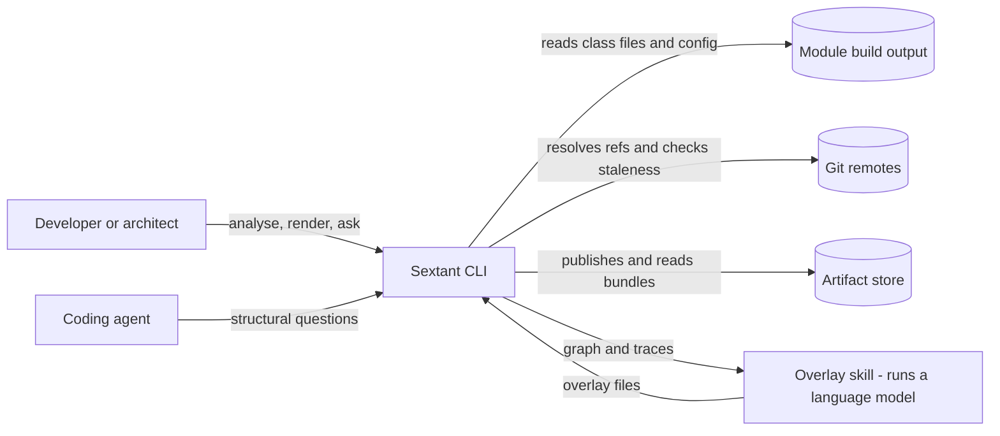
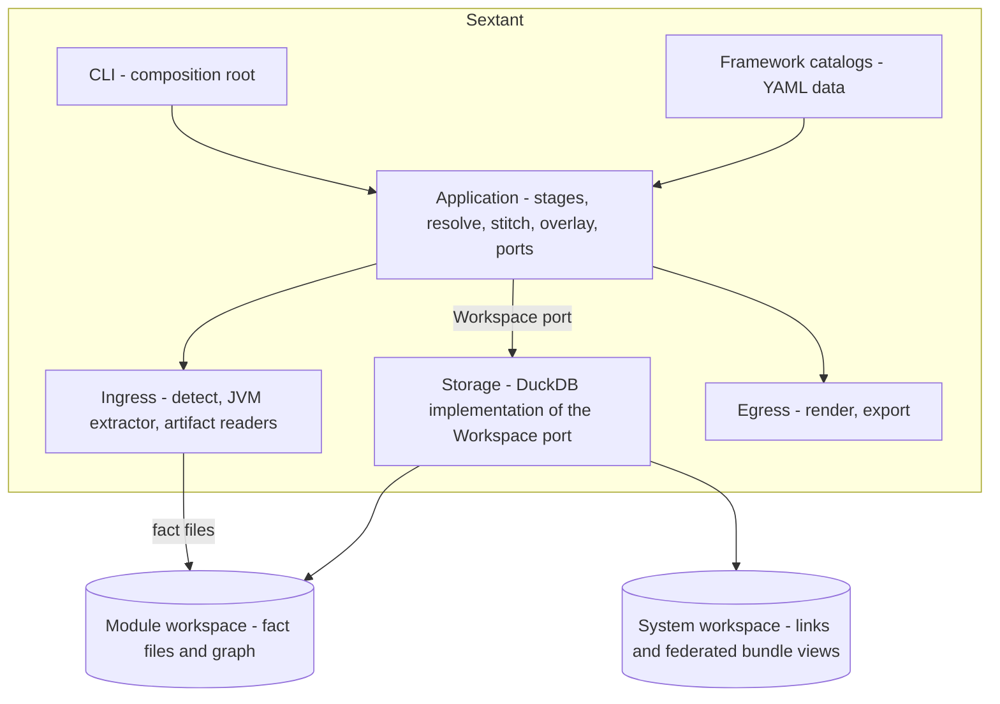
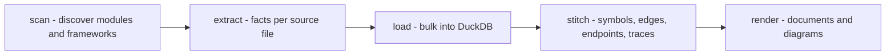

# ARCHITECTURE

How Sextant is built, and why. Must remain consistent with
[REQUIREMENTS.md](REQUIREMENTS.md). Terms are defined in [CONTEXT.md](../CONTEXT.md).

This document is authoritative for the shape of the system and for the decisions behind it.
**Each component's own contract is authoritative for what happens inside it** — see
[components/](components/README.md), where `Dnn` documents are data contracts and `Mnn`
documents are runtime modules.

---

## 1. Shape

Sextant is a pipeline with a hard seam in the middle. One side reads artifacts and emits
**facts**. The other side derives everything — graph, endpoints, traces, diagrams,
answers — from facts alone and knows nothing about languages, frameworks, or file
formats.

The fact schema is the contract between the two. It is the most consequential artifact in
the project: a new language, a new framework, or a new artifact format is a new producer
of the same facts, and touches nothing downstream.

---

## 2. Context



Sextant never calls a language model. The overlay skill runs outside it, under the user's
own model and subscription, and its output re-enters as validated overlay files. See
[DR-2](#dr-2--no-language-model-inside-sextant).

> **Amendment (2026-09-02, Phase 2K design §8 — approved, delivered).** The diagram and
> paragraph above predate `enrich`, which is now the one call in the whole codebase that
> breaks the "never calls a language model" statement — see DR-2's own amendment for the
> current shape (an adapter behind a port, inside Sextant's process, not an external skill).

## 3. Containers



Catalog engines run inside `application/resolve` — they are not a separate box, because
framework interpretation is core computation driven by catalog data. Ingress writes fact
files and never reads the graph; egress reads through the port and never writes.

---

## 4. Pipeline



| Stage | Component |
|---|---|
| scan | [M02 detector](components/M02-detector.md) |
| extract | [M03 scanner](components/M03-scanner.md) |
| load, stitch | [M04 resolver](components/M04-resolver.md) |
| render | [M07 renderer](components/M07-renderer.md) |

The system tier has its own, shorter pipeline — **sync, stitch, render**
([M05](components/M05-sync.md), [M06](components/M06-stitcher.md),
[M07](components/M07-renderer.md)) — with **no load stage**: the system workspace holds
links and participants natively and federates everything else as views over the bundles.

**One producer per module, per artifact kind.** No source file ever carries facts from two
extractors. Where a language needs two readers, the adapter that owns it performs the
merge internally and the pipeline sees one fact stream. Two producers for one file means
reconciling two versions of the truth at query time — a cost that accumulates in the
stitcher forever and serves nothing.

**Stages are internal.** `analyze` runs the whole pipeline. `--from-stage` and
`--to-stage` exist for debugging and are not part of the command surface in
[FR-20](REQUIREMENTS.md#fr-20--command-surface).

**Derived data is rebuilt whole.** Facts are maintained per source file; every table
derived from them is recreated on each run. Patching a derived table in place cannot be
made correct — adding one implementation of an interface invalidates dispatch edges in
files that did not change.

---

## 5. The fact model

Specified in [D00 fact schema](components/D00-fact-schema.md); the tables derived from it in
[D01 graph schema](components/D01-graph-schema.md). Summarised here because the rest of this
document depends on it.

Three layers. The first two are language-neutral; the third is where language-specific
detail is confined.

| Layer | Holds |
|---|---|
| **Identity and reference** | Symbols, occurrences, relationships, documents |
| **Sextant extensions** | Annotations with arguments, shapes and their fields, call sites with candidate sets, string literals, configuration entries |
| **Language extension namespace** | Per-language detail under `ext.<lang>`, readable only by that language's adapter |

The second layer exists because the standard reference formats deliberately model neither
annotation arguments nor call sites, and both are load-bearing for
[FR-3](REQUIREMENTS.md#fr-3--endpoint-catalog) and
[FR-5](REQUIREMENTS.md#fr-5--call-graph).

### Identity

Symbols are named with the SCIP symbol grammar. It is a string format, not a tool: no
indexer is involved. It gives content-derived identifiers that satisfy
[NFR-3](REQUIREMENTS.md#nfr-3--stable-identity), and it carries package and version inside
the identifier, so the same library type observed from two modules produces the same
string and the graphs join without a linking mechanism.

Short identifiers presented to users are always prefixed — `sym_3f8b`, `ep_7c1a` — never
bare hexadecimal, because they get pasted into files that coerce types.

### Trust

Three independent concepts, never collapsed — two stored per fact, one derived. See
[DR-3](#dr-3--three-trust-fields-rather-than-one-confidence-score).

| Field | Values | Stored |
|---|---|---|
| `resolution` | `resolved`, `narrowed`, `partial`, `unresolved` with a reason | Yes |
| `evidence` | `compiler`, `syntax`, `name_match`, `declared`, `human`, `llm` | Yes |
| `precedence` | human 90, code 50, model 10 | No — a fixed function of `evidence`, applied at conflict time |

The line between `narrowed` and `partial` is decided by visibility: a type that nothing
outside the indexed set can implement yields a complete candidate set.

Tool identity and language are recorded once per document, never per fact.

### Closed sets

Per [NFR-5](REQUIREMENTS.md#nfr-5--closed-construct-sets): six root kinds, eight terminal
kinds, four resolution values, six evidence values, and the construct kinds. Widening any
of them is a schema change requiring re-extraction.

---

## 6. Module layout

The outer layer is grouped **by role, not under one "adapters" name**, because each role
obeys a different rule (§10) — one shared name forced one weak rule where three names allow
three strong ones. And two things that look like adapters are deliberately *not* out there:
dispatch resolution and link matching are the core computation of the product, so they live
in `application/`, with only their SQL bodies in `storage/`.

```
domain/            graph model, symbol grammar, closed sets, trust fields    D00, D01
application/
  ports/           Workspace, Detector, Scanner, ArtifactReader,
                   Engine, Overlay, Projection
  resolve/         M04 — pass orchestration, dispatch and matching semantics
  stitch/          M06 — link semantics
  overlay/         M01 — validation, per-slot precedence, open questions
  stages/          pipeline orchestration — language-blind
ingress/
  detect/          build-tool adapters                                       M02
  extract/jvm/     ASM subprocess wrapper and fact mapping                   M03
  read/            config, kubernetes, helm, openapi, protobuf               M03
  catalogs/        Sextant's own framework catalogs                          D02
  overlay-files/   overlay file reading                                      D03
storage/
  duckdb/          the Workspace implementation, and the SQL bodies of
                   D01's named derivations and named queries                 D01
egress/
  render/          projections, view model, mermaid emitter, templates       M07
  export/          bundle writer                                             M08, D06
catalogs/          framework YAML and conformance fixtures                   D02
cli/               composition root: builds registries, wires selections     M00
extractor-jvm/     the Java source of the ASM extractor                      M03
```

**`ingress` is everything read from disk that is not the workspace** — not only the analysed
module's artifacts. `read/` holds the module's own files and `catalogs/` holds Sextant's, and
the distinction matters: the module's configuration becomes facts, while a catalog is
framework knowledge that produces none.

**Dependencies flow inward.** `domain` imports nothing from the project. `application`
imports `domain` only. `ingress`, `storage` and `egress` import `domain` and
`application.ports` — **never each other**. `cli` is the only place that knows every
concrete type.

**Where the derivation SQL lives.** [D01](components/D01-graph-schema.md) declares the named
derivations and named queries as part of the schema; `storage/duckdb/` holds their SQL
bodies as the implementation of that contract; `application/resolve` and
`application/stitch` own the semantics and the ordering. All dialect-specific SQL stays in
one place, behind the port.

**Every selection is a set, never a single value.** A repository may hold Java and Kotlin,
Spring and Micronaut. Scanners are selected per language, artifact readers per file kind,
catalogs as the active set, overlays by rank. Nothing in the pipeline branches on a
language name.

**The composition root builds the registries; selection happens where the information
exists.** A detector is chosen from a path, which `cli` has. A scanner is chosen from a
module's languages, which nothing knows until detection has run — so the registry is handed
to the stage and the choice is made there. The *rule* for choosing sits beside the port that
declares `accepts` and `rank`, so a second composition root cannot combine them differently
and make the port mean two things.

---

## 7. Extension points

Each is a Protocol in `application/ports`. Adding an implementation requires a new file
and one registry line, and changes no existing test.

| Port | Contract | Defined in |
|---|---|---|
| `Workspace` | Load facts in bulk, run the named derivations, answer the named queries of [D01](components/D01-graph-schema.md) — nothing else, so it cannot decay into a SQL pass-through. | [D01](components/D01-graph-schema.md) |
| `Detector` | Given a path, report what the repository contains. Keyed by build system. | [M02](components/M02-detector.md) |
| `Scanner` | Given a module, emit facts. Declares `accepts`, `capabilities`, `rank`. | [M03](components/M03-scanner.md) |
| `CatalogSource` | Yield every catalog it holds. A port rather than a directory because §6 of [D02](components/D02-catalog-schema.md) loads the built-in set and a repository's own together and privileges neither — so the layer that interprets catalogs never learns where they came from. | [D02](components/D02-catalog-schema.md) |
| `ArtifactReader` | Given files of one kind, emit facts, marking whether the build consumes them. | [M03](components/M03-scanner.md) |
| `Engine` | Given catalogs and facts, materialise endpoints. Declares required capabilities. | [D02](components/D02-catalog-schema.md), [M04](components/M04-resolver.md) |
| `Overlay` | Given files and a lookup, emit validated claims with a rank. | [M01](components/M01-overlay.md) |
| `Projection` | Given a graph scope, produce a view model. | [M07](components/M07-renderer.md) |
| `Renderer` | Given a view model, produce output. Adds no information. | [M07](components/M07-renderer.md) |
| `Progress` | Receive task lifecycle events — defined, started, finished, failed-with-reason, each timed. Implemented by the CLI's display; **modules never print.** | [M00](components/M00-cli.md) |

**Capabilities are the branching mechanism.** A scanner declares what it can do —
annotation arguments, `invokedynamic` resolution, constant propagation, chain
reconstruction, type-annotation reading, constant values, source attribution, Kotlin
metadata. An engine style declares what it requires. An engine runs only where its
requirements are met, and `module status` reports every catalog skipped for a missing
capability, per [FR-17](REQUIREMENTS.md#fr-17--coverage-reporting).

**Framework support is data.** A new framework in an existing style is one catalog file
and one fixture. A framework needing a new style is one new engine.

---

## 8. Storage and file layout

Configuration, exclusion and redaction are specified in
[D04](components/D04-config-and-exclusion.md); the manifest and state files in
[D05](components/D05-manifest-and-state.md); the bundle in
[D06](components/D06-bundle-format.md).

```
~/.sextant/
  config.yml                     user configuration
  cache/                         dependency fact cache — third-party signatures and
                                 first-party full facts, keyed by artifact checksum

<repo-root>/.sextant/
  modules.json                   module inventory: one row per module — its id, its
                                 root-relative dir, its kind, whether this run analyzed
                                 it or skip-listed it, and — skip-listed only — the
                                 reason why (2M design §2, fix round 1). No separate
                                 "workspaces" field: a module's workspace is always
                                 `<dir>/.sextant`, derived from `dir` rather than stored.

<module-root>/.sextant/
  metadata.json                  identity, provenance, coverage, counts
  state.json                     run state, stage completion, cache keys
  workspace.duckdb               the derived graph
  facts/**/*.jsonl               one file per source file
  render/                        documents and diagrams

<system-root>/
  system.yml                     manifest: services, aliases, refs, environment
  curations.yml                  human overrides
  .sextant/system/
    state.json                   scanned commits and staleness
    workspace.duckdb             the linked graph
    proposals.yml                candidates awaiting curation
    render/

<repo-root>/.sextantignore       cascading, version-control ignore syntax
```

**Humans write YAML, machines write JSON.** YAML coerces types by guessing — `1e10` becomes
a float, `1.10` loses its trailing zero — and the machine-written files hold commit hashes
and version strings. `proposals.yml` is the one crossover: machine-written, but it exists
to be edited into a curation.

**Each module workspace is self-contained.** It holds the module plus its dependency
closure — first-party read in full, third-party as signatures. A sibling module in the same
repository enters as a first-party dependency through its build output, by build
declaration, so the monorepo is not a special case. The duplication this implies is kept
cheap by the dependency fact cache.

**Facts partition by source file, not class file.** Inner and anonymous classes produce
separate class files but always change together, so the source file is the unit of change.
The mapping comes from the class file's own source attribute.

**JSONL in the workspace, Parquet only in bundles.** At per-source-file sizes a columnar
footer costs more than the data, and bulk JSON loading is already fast enough. Bundles are
single large files where compression and portability matter.

**The workspace persists.** It is the product, not an intermediate. `render` and every
query read it without re-analysing.

**Redaction happens at the EXITS**, and the workspace stays verbatim. Masking runs where
data crosses the trust boundary — the rendered document (`api.py::render`), the exported
bundle (`api.py::export`), and the enrichment tools' read path — never during extraction.
The reason is `resolved_config`: analysis needs the real values locally, because peer
resolution substitutes real addresses into endpoint expressions, and a workspace of masked
values is a workspace that cannot answer. **So `<module>/.sextant/facts/**` holds
unmasked values, and a workspace is not safe to copy, share or commit on the strength of
this section.** Every document written locally carries `redaction_set_hash: sha256:none`,
which is the fact stream saying so; the exporter produces the real hash for the bytes that
leave. [D04](components/D04-config-and-exclusion.md) §4 is the full amendment, approved
2026-09-02 with Phase 2K's design.

*This paragraph read "Redaction happens during extraction, before anything is written. The
cache key includes the redaction pattern set, because a pattern added later cannot clean
facts already written." Both sentences were false: the amendment landed in D04 and never
here (§5.1), and there is no cache at all. It is corrected rather than deleted because
NFR-8 is a confidentiality claim and this is the first document a reader opens —
`docs/open-issues.md` OI-84 carries the finding as `A-C8`.*

---

## 9. Technology

> **Approved 2026-08-27.** Dependency choices per `GUIDELINES.md` §7 — the core stack below
> was signed off wholesale; the tool rows added by the capability audit (`click`, `rich`,
> `jsonref`, `asm-analysis`, `kotlin-metadata-jvm`, `protobuf`, the Gradle init script)
> were each decided individually in review.

| Concern | Proposed | Why |
|---|---|---|
| Language | Python 3.12+ | Best iteration loop for the bulk of the work, which is catalog and query development. Every heavy operation is a subprocess or a database query. |
| Storage and query | DuckDB | Columnar, embedded, reads JSONL directly, recursive queries for reachability. Keeps graph work out of Python loops. |
| Bytecode reading | ASM | See [DR-1](#dr-1--asm-over-class-files-rather-than-a-source-indexer). Its sibling artifacts, `asm-tree` and `asm-analysis`, ride at the same version and are shaded into the extractor jar identically. |
| Extractor packaging | Shipped inside the Python distribution. Gradle builds the shaded jar straight into `src/sextant/extractor-jvm/`, git-ignored, and hatchling's `artifacts` carries it into the wheel | Version drift between extractor and loader is a silent correctness fault, so the two travel as one artifact. One location, checkout and wheel alike. It is a build output, not a committed file, so a fresh clone has none until `./gradlew build` runs — reported by name where it is needed rather than at install time. `force-include` was tried and is mandatory in hatchling: a missing jar became a `pip install` failure, which is an install-time hard error for a file only `module analyze` needs. |
| JVM extractor build | Gradle, shaded jar | Kotlin compiler and `kotlin-metadata-jvm` versions must move together — the metadata library's supported version trails the compiler's, so a class compiled by a newer Kotlin carries metadata the reader cannot parse. Both are 2.4.20, and `KotlinMetadataVersionTest` pins the range the library reads |
| Python packaging | `pyproject.toml`, hatchling backend | Named by `GUIDELINES.md` §11. Catalogs live at `src/sextant/catalogs/` so they travel with the code that interprets them, and are resolved through the installed package rather than from a file's position on disk. |
| Test framework | pytest | |
| Assertions | Plain `assert`, pytest introspection | No assertion library. |
| Test doubles | Fakes by default; `unittest.mock` only at boundaries we do not own | `GUIDELINES.md` §10 |
| Integration harness | Fixture repositories, built in CI | |
| Formatter and linter | ruff | One tool, both jobs |
| Types | mypy, strict | |
| Architecture tests | **import-linter**, and source rules in `tests/architecture/` | Import contracts in CI per `GUIDELINES.md` §5.2. Import contracts cannot see what a file *says*, so §10's content rules — no framework in code, storage ignorance, language confinement — parse the source instead. No extra dependency: `pytest-archon` does import rules, which import-linter already does better. |
| JVM tests | JUnit 5 | |
| CLI framework | click | Noun→verb groups are its native shape; `CliRunner` tests commands in-process |
| Console status | rich | Live in-place task display on **stderr**; auto plain-line fallback when not a terminal |
| OpenAPI `$ref` resolution | jsonref | Mechanics only — splice, pointers, laziness; **policy lives in our loader** (D04) |
| Bytecode dataflow substrate | asm-analysis | The `Analyzer`/`Interpreter` skeleton under constant propagation and chain reconstruction |
| Kotlin metadata | `org.jetbrains.kotlin:kotlin-metadata-jvm` | Nullability and data-class shapes; rides inside the extractor jar. Kotlin 2.0 renamed both the artifact and its package from `kotlinx-metadata-jvm` / `kotlinx.metadata`, so anything written against the old name is describing a library this project does not ship |
| Descriptor parsing | protobuf (Python) | Parses `FileDescriptorProto` bytes extracted from generated classes |

### 9a. Tool capability matrix

The audit behind this table walked each step's schema obligations against the tools' actual
API surfaces. The recurring test: **a library earns its place when it absorbs mechanics; it
never sets policy.** Policy — offline defaults, refusal-as-reported-gap, cycle semantics —
is Sextant's in every row.

| Step | The tool provides | Built in-house |
|---|---|---|
| Detect, Maven | `dependency:build-classpath -o`, `help:effective-pom` | Invocation and parsing |
| Detect, Gradle | The evaluated project model — but only from inside a build | **The init script**: run via the project's own wrapper (`gradlew --offline -I …`), registers a task printing modules, source sets, classpaths and output dirs as JSON. No client library, no version matrix; conformance fixtures pinned per Gradle major. |
| Scan, structure | ASM: annotations with arguments, type annotations, constants, generic signatures, parameter names, lambdas' bootstrap handles, source and line attribution, throw sites | Fact mapping |
| Scan, hard parts | asm-analysis: the dataflow skeleton | **String-constant propagation** (incl. Java 9+ concat recipes), **chain reconstruction**, **control-flow structuring** (CFG, back-edge loops, dominator regions) |
| Scan, Kotlin | kotlin-metadata-jvm | Mapping to `ext.kotlin` |
| Read, contracts | PyYAML; jsonref; protobuf; `helm template` | Profile layering; the `$ref` policy loader; **embedded-descriptor extraction** (M03); wire-type projection |
| Resolve, query | DuckDB: bulk JSONL load, recursive CTEs, FTS, Parquet federation | All semantics: CHA and RTA, matching, named derivations and queries — cycle detection in recursive walks is manual (path-column technique) |
| Sync | git: `ls-remote`, blobless partial clone | Two-phase staleness, refusals |
| Render | — | Mermaid emitters (verified: `alt`/`opt`/`loop`/`par`, class-diagram generics); **large diagrams must be split** — Mermaid's default text-size cap truncates, so chunking is the emitter's job |
| Export | DuckDB `COPY TO` Parquet, ordered, fixed compression | Manifest, determinism discipline |
| CLI | click, rich | The `Progress` event contract; every policy rule in M00 |

Future languages, verified to the depth of the earlier survey: Go's `go/types` + `go/ssa` +
VTA provides typed dispatch with candidate sets and needs only a fact emitter around it;
rust-analyzer's SCIP output lacks call sites and macro arguments, making Rust the one
genuine two-pass language.

**Test naming convention:** `test_<subject>_<expected behaviour>_when_<condition>`, so a
name reads as a specification per `GUIDELINES.md` §10 — for example
`test_endpoint_catalog_records_unresolved_topic_when_placeholder_missing`.

---

## 10. Architecture rules

Run with the unit suite. An untested rule is already being violated — so each row below
names the mechanism that tests it, and a rule with no mechanism is not a rule.

Two mechanisms, because they answer different questions. **import-linter** reasons about what
a file *imports*; it cannot see what a file *says*, and a protocol name in a query is a
perfectly legal import. **Source rules** (`tests/architecture/`) parse the source and read
identifiers and string literals, ignoring comments and docstrings — explaining why a rule
exists usually means naming the thing it forbids.

| Rule | Contract | Tested by |
|---|---|---|
| Layering | `cli` → `{ingress, storage, egress}` → `application` → `domain`, one direction only | import-linter |
| Application purity | `application` imports no outer group | import-linter |
| Adapter independence | `ingress`, `storage` and `egress` never import one another — everyone depends on the ports | import-linter |
| **Ingress is write-only** | Nothing in `ingress/` depends on `Workspace` at all: readers emit facts and can never read the graph back | import-linter |
| **Egress is read-only** | Nothing in `egress/` writes facts or derived tables: a renderer that writes is derivation hiding in presentation | import-linter |
| Storage ignorance | `storage/` knows SQL and D01; it never names a framework, a language, or a protocol | source rule |
| Language confinement | Only `ingress/extract/jvm` names JVM languages or bytecode. The composition root is excepted: naming concrete adapters is what it is for | source rule |
| Extension namespace | Only a language's own adapter reads its `ext.<lang>` namespace | source rule |
| **No framework in code** | No framework is named anywhere outside the catalogs — the claim the whole design rests on | source rule |
| **Ports hold only contracts** | Protocols, frozen dataclasses, errors, and do-nothing implementations. A port that grows behaviour stops being a seam | source rule |
| **Closed sets defined once** | Only `domain/closed_sets.py` defines one; a second definition is NFR-5 widened by accident | source rule |
| **Application reads no files** | Every I/O concern reaches `application` through a port | source rule |
| **A feature with an open Critical or Major does not claim to be delivered** | `COVERAGE.md` §2's `✅` means every library catalogued; delivery additionally requires no open blocker. Both directions checked, and every Critical or Major must be placed against the feature it blocks | source rule (`test_feature_delivery.py`) |
| **Every feature has an intention test** | A fixture a user of the framework would recognise, plus an assertion on DERIVED output — never on one of our own documents. `GUIDELINES.md` §4.1 | source rule (`test_feature_intention.py`) |

**Three registers, not seven** (2026-09-11). `docs/` holds one register per question:
`open-issues.md` — what is wrong and open; `java-kotlin-delivery-list.md` — what is not
delivered, enforced by tests; `COVERAGE.md` — what we cannot see and say so.
`java-gap-analysis-2026-09-06.md`, `documented-not-implemented.md` and
`principles-sweep-2026-09-05.md` were folded into those three and removed; their live
content is `OI-83`, `OI-84` and the delivery list's own `severity` block, and their history
is in git.

**Exceptions are written down, never absorbed.** A rule quietly loosened until it passes still
reads as enforcement. One is currently recorded in the suite: `domain/facts.py` names a field
`classpath`, which is a JVM name for a language-neutral idea — the ordered set of places
symbols were read from, each with a tier. Renaming it is a [D00](components/D00-fact-schema.md)
schema change, so the rule asserts the leak exists rather than ignoring it, and fails if a
second one appears.

## 11. Decision records

### DR-1 — ASM over class files, rather than a source indexer

Sextant reads compiled class files with ASM, and does not use a SCIP indexer or a source
parser to learn what code does. The obvious modern choice is a SCIP indexer, so this needs
recording: **the SCIP schema models neither annotation arguments nor call sites**, and
those are precisely what an endpoint catalog is made of.

**Considered options.** *tree-sitter over source* cannot resolve a name to a type. *A SCIP
indexer* resolves types but drops the arguments, requiring a second syntax tier to recover
them — and what that tier recovers reaches no deliverable, while every downstream consumer
pays a permanent reconciliation cost for the second producer. *ASM* gives resolved
targets and annotation arguments in one pass, because every framework annotation Sextant
needs has runtime retention; a framework that reads its annotations reflectively cannot
erase them.

**Consequences.** A successful build is required. Comments and source-retention
annotations are unavailable — measured as reaching no requirement. One reader covers Java
and Kotlin, and reads first-party dependency jars with no source and no build, which is
what lets an outbound call hidden inside a shared client library still be found. A JVM
must be present, which costs nothing because building already required one.

**What was kept from SCIP:** its symbol grammar, as a string format only.

### DR-2 — No language model inside Sextant

Sextant is fully deterministic and never calls a language model. Component naming, diagram
simplification, and dispatch presentation are produced by a skill running outside Sextant,
under the user's own model, and re-enter as overlay files that are validated against the
graph before use.

**Considered options.** Inference stages inside the pipeline make the product turnkey, but
leave one tier that golden-output testing cannot cover, put a provider dependency tree in the core install, and tie model churn to
releases.

**Consequences.** [NFR-1](REQUIREMENTS.md#nfr-1--determinism) covers the entire product
rather than most of it. Full documentation takes two commands rather than one. Because an
overlay may name only symbols that exist, invention is prevented structurally rather than
detected afterwards — an unvalidated inference stage will eventually report boundaries that
exist in no code, and validation-by-construction is the only check that cannot be forgotten.

> **Amendment (2026-09-02, Phase 2K design §8 — approved, delivered).** The deterministic
> pipeline — `analyze`, `resolve`, `render`, `export` — still never calls a model, and stays
> under [NFR-1](REQUIREMENTS.md#nfr-1--determinism) in full. `enrich` is the **one sanctioned
> caller**, added behind a new port (`application/ports/enrichment.py`'s `EnrichmentAgent`),
> never called from anywhere else in the pipeline. This replaces the external-skill design
> above, not merely extends it: there is no skill running outside Sextant under the user's
> own subscription any more — the call happens inside Sextant's own process, through an
> adapter (`tradewind` since 2N — one file, `src/sextant/agents/tradewind.py`, driving the
> user's Tradewind library through its public client, import-confined by a structural
> test; 2K's `claude-api` was its proof-of-shape and is deleted), authenticated either by
> the machine's own Claude Code login or by `ANTHROPIC_API_KEY` read from the environment
> alone. What DR-2 protected survives
> unchanged: no invention (the overlay is validated by construction exactly as before,
> `application/enrich/validate.py`), no provider dependency tree in the deterministic core
> (the adapter lives in its own outer group, `src/sextant/agents/`, importing no other outer
> group), model churn decoupled from releases (a registry-keyed `--agent`, `--model` passed
> verbatim). `--dry-run`/`--ingest` remain the universal door DR-2's original external-skill
> shape argued for: a human, Codex, Cursor or any other agent can still answer the brief
> under its own permissions, entirely outside Sextant's process. See
> [D04](components/D04-config-and-exclusion.md) §4b for the port, the adapter, the jail and
> the two doors in full, and [D06](components/D06-bundle-format.md) §2 for what the
> enrichment call actually produces in the rendered outputs.

> **Amendment (2026-09-02, Phase 2K design §8 — approved, delivered), on
> [NFR-1](REQUIREMENTS.md#nfr-1--determinism).** Only the model call inside `enrich` itself is
> excluded from determinism — everything around it stays byte-deterministic: the brief
> composed for a given workspace, the validation a returned answer is checked against, and
> the assembly that interleaves a written overlay into the rendered document. Same workspace
> plus same `.sextant-enrichment.json` produces the same `architecture.md`/`architecture.html`
> every time, whether that overlay came from a live agent run, `--ingest`, or was committed by
> a person editing nothing — `render`, re-run standalone over a workspace with an overlay
> already on disk, takes the identical code path `enrich`'s own auto-assembly does, so the two
> can never disagree. See [REQUIREMENTS.md](REQUIREMENTS.md#nfr-1--determinism) for the
> requirement text with the same note.

### DR-3 — Three trust concepts rather than one confidence score

Every fact separates `resolution` (how certain is the target) from `evidence` (what
produced it); `precedence` (who wins a conflict) is a fixed function of evidence, applied at
conflict time and never stored. Comparable tools carry one score, so the reason needs
recording: **the concepts answer different questions, and collapsing them makes some true
statements unrepresentable.**

A human-curated fact must outrank code *and* be treated by consumers as proven. With one
score that is a contradiction. Separated, it is `evidence: human` — which implies rank 90 at
conflict time — and `resolution: resolved`, and no conflict exists.

**Consequences.** Every consumer must be explicit about which concept it reads: agents and
reports read `resolution`; only conflict resolution computes precedence. A single number
would also invite averaging along a path, which has no meaning. Precedence stays unstored
because it is policy, not observation — storing it would admit illegal states and freeze the
rank table into published bundles. A single field grading extractor quality cannot also
express "one of these four", which is the gap the separation closes.

### DR-4 — Authority follows the build, not a fixed precedence rank

When a contract artifact and code both describe the same endpoint, authority is decided by
inspecting the build. An artifact the build consumes produces facts. An artifact it does
not consume is documentation: it produces no facts, and is used only for drift comparison.

**Considered options.** A fixed rank — code always outranks a specification — is simpler
and wrong, because a committed generated file may have been produced from a version of the
artifact that no longer exists in the repository. Nothing about the two files reveals
which. The build does.

**Consequences.** The classification is a property of the build, so there is no rank table
to read, which is why this is recorded. Where a generated artifact embeds the schema it was
generated from, that embedded schema is compared, which makes drift detection exact rather
than approximate. This narrows the precedence ranking to three tiers, since the
specification tier and the library tier both dissolve.

### DR-5 — Links matched by directional structural compatibility

An outbound endpoint is linked to an inbound endpoint only when protocol, wire identity
**and payload compatibility** all agree. Compatibility is directional: the client's request
must satisfy every field the server requires, and the server's response must satisfy every
field the client declares.

**Considered options.** Matching on protocol, method and path is what comparable tools do
and is cheaper. In an estate where many services expose the same path shape, it invents
dependencies that do not exist — which are then drawn on a system diagram and reasoned from
by an agent. The failure mode is fabrication, not imprecision.

**Consequences.** Comparison is on wire identity, never type names, so a rewritten schema
still matches. Where a format publishes compatibility rules, those rules are applied rather
than reimplemented. Discriminating power varies with shape richness, but that needs no
threshold: a thin shape simply survives against several candidates and is recorded as
`narrowed` with all of them listed. This is more expensive than path matching and would
look like a candidate for simplification, which is why it is recorded.

### DR-6 — Predicted behaviour mirrors the framework, exactly

Sextant does not do error handling of its own over the code it analyses — it predicts
what the language and framework under analysis will do. Wherever the framework repairs a
declaration, Sextant repairs it identically; wherever the framework raises, Sextant
records the declaration as an error. No deviation: a path Spring would serve after
normalising is derived normalised, and never in a spelling Spring would not serve.
A catalog supporting one framework mirrors that framework. Where two supported
frameworks behave differently on the same declaration shape, the behaviours live in
separate per-framework units — separate catalogs carrying the difference as data
(a separator, a default, a refusal), or separate adapter modules where data cannot
express it — never one unit approximating both.

**Considered options.** Doing our own "sensible" handling — normalising nothing, or
normalising by our own rules — is simpler and produces confidently wrong identities:
bare prefix-concatenation once derived `/api/gatewayowners/{ownerId}` at `resolved`
evidence for a route Spring serves as `/api/gateway/owners/{ownerId}`. A wire identity
that differs from what the runtime serves fails DR-5's linking silently, which is
fabrication's quiet twin: a real dependency that can never match.

**Consequences.** Framework behaviour becomes catalog data wherever possible (the path
separator, Maven's parent-coordinate inheritance), so mirroring a second framework's
divergent rule is a data change, not a code branch. This rule governs *predicted*
behaviour only: errors in Sextant's own inputs — a malformed catalog, an unreadable
schema — remain refusals and recorded gaps under the unresolved-is-an-answer rule,
because there is no framework whose behaviour they predict. When a framework's repair
behaviour is unknown, the honest output is `unresolved`, never a guess at what the
repair might be.

---

## 12. Open decisions

Not yet decided, and not to be assumed.

Each component document carries its own. The ones that shape the architecture rather than
one component:

| Decision | Blocks | Tracked in |
|---|---|---|
| Which clustering algorithm proposes components | the design *scenario* ([REQUIREMENTS.md](REQUIREMENTS.md#usage-scenarios), formerly FR-13) and the overlay skill — **not a Sextant requirement**, so the question is a consumer's (W51) | [M04](components/M04-resolver.md) |
| The field-list residue of [D00](components/D00-fact-schema.md) — §5a settled the structure; what remains lands with the validated models | NFR-10's schema-as-code | [D00](components/D00-fact-schema.md) |
| Repository initialisation under version control | `GUIDELINES.md` §11 | [PROJECT.md](PROJECT.md) |

Three decisions formerly here were closed by sign-off on 2026-08-27:

- **Control-flow scope for version 1: loops, optionality, and grouped alternatives with
  unlabelled branches.** Named conditions (`alt` labelled `if order.isExpress`) are out of
  version 1 and recorded as a known gap. This satisfies [FR-6](REQUIREMENTS.md#fr-6--traces)
  as written — alternatives, loops and optional branches are distinguishable — and it
  remains the largest single piece of in-house work in [M03](components/M03-scanner.md).
- **Rapid type analysis ships in version 1**, on top of hierarchy analysis — the ~hundred
  lines that keep `List.iterator()` from fanning out to every collection on the classpath.
- **Section 9 in full.**
