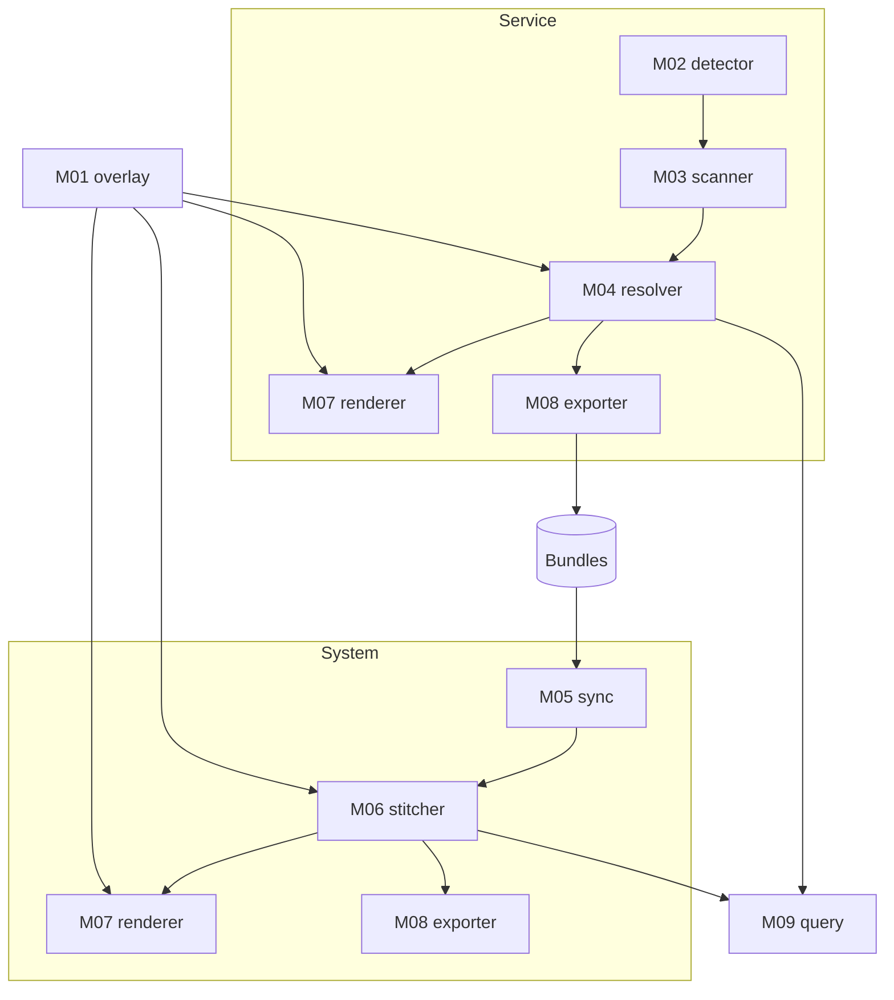

# Components

Two kinds of document.

**`Dnn` — data definitions.** Contracts. Written by one component, read by others, and
never allowed to drift apart (`GUIDELINES.md` §5.1).

**`Mnn` — modules.** Runtime units. Each has one responsibility and an interface;
implementations are keyed by **backend**, never by language name.

Terms: [CONTEXT.md](../../CONTEXT.md). Requirements: [REQUIREMENTS.md](../REQUIREMENTS.md).
Structure and decisions: [ARCHITECTURE.md](../ARCHITECTURE.md).

---

## Data definitions

| # | Document | Written by | Read by |
|---|---|---|---|
| [D00](D00-fact-schema.md) | Fact schema and identity | M03 | M04, M06 |
| [D01](D01-graph-schema.md) | Graph schema | M04, M06 | M07, M08, M09 |
| [D02](D02-catalog-schema.md) | Framework catalog | People | M04 |
| [D03](D03-overlay-schema.md) | Overlay files | People, the skill, M06 | M01 |
| [D04](D04-config-and-exclusion.md) | Configuration, exclusion, redaction | People | M02, M03, all |
| [D05](D05-manifest-and-state.md) | Manifest and state | People, M04, M05 | M05, M06 |
| [D06](D06-bundle-format.md) | Bundle format | M08 | M05 |

## Modules

| # | Module | Responsibility |
|---|---|---|
| [M00](M00-cli.md) | Command line | Composition root and the noun-verb surface |
| [M01](M01-overlay.md) | Overlay | Validate claims, resolve precedence, record open questions |
| [M02](M02-detector.md) | Detector | Work out what a repository contains |
| [M03](M03-scanner.md) | Scanner | Turn code and artifacts into facts |
| [M04](M04-resolver.md) | Resolver | Turn facts into a graph |
| [M05](M05-sync.md) | Sync | Assemble the participant set for a system |
| [M06](M06-stitcher.md) | Stitcher | Match endpoints across participants |
| [M07](M07-renderer.md) | Renderer | Turn a graph scope into diagrams and documents |
| [M08](M08-exporter.md) | Exporter | Write a workspace out as a bundle |
| [M09](M09-query.md) | Query | Answer structural questions about a workspace |

---

## The two pipelines

**The read-only-upstream rule holds within one pipeline run.** M05 reads bundles that M08
produced in an **earlier, separate run** of the service pipeline. That is the only edge
that crosses runs, and it is why a bundle must be self-describing.

**M00 is numbered first for reading order, not dependency order.** The CLI imports every
module; **no module imports the CLI.** That is what keeps a module testable with fakes and
no wiring.

---

## Closure

The two end documents must be producible from the chain. Tracing every input to a
producer:

**Module architecture document — M07 at module scope**

| Section | From | Which needs |
|---|---|---|
| Endpoint catalog | M04 | M03 annotations and call sites, resolved config, shapes, D02 catalogs |
| Payload contracts | M04 | M03 field declarations and declared contracts |
| **Class diagrams** | M07 | M04 types, hierarchy, containment, fields |
| **Sequence diagrams** | M07 | the `trace_of` walk over M04's graph, needing M03 control-flow position and dispatch candidate sets |
| Findings | M04 | The graph |
| Coverage and honesty | M02 source sets, M03 uncovered list, M04 tier counts | — |
| Component names and purposes | M01, optional | Renders without it |

**System architecture document — M07 at system scope**

| Section | From | Which needs |
|---|---|---|
| Participants | M05 | `system.yml`, bundles |
| Service map and contracts | M06 | M05, plus endpoints and shapes inside bundles |
| **Cross-service sequence diagrams** | M07 | Traces from each bundle, joined at terminals by M06 links |
| Unmatched and uncalled | M06 | Endpoints from bundles |
| Open questions | M01 | M06 |

**Why the cross-service chain works.** M04 ends each trace at a classified terminal; one
kind is `outbound_call`. M06 matches an outbound endpoint to an inbound endpoint — and an
inbound endpoint is what a trace starts from. **The terminal of one trace and the root of
the next are the same join.** No new fact kind is required.

---

## Every module document has the same sections

1. **Purpose** — one sentence, no "and"
2. **Interface** — the contract, and how implementations are selected
3. **Inputs** — components read and raw sources touched
4. **Output** — the exact shape produced
5. **Behaviour** — what it does, including how it fails
6. **What it must not do** — the boundaries that keep the chain acyclic
7. **Honesty obligations** — what it must report rather than absorb (NFR-2)
8. **Open decisions**
