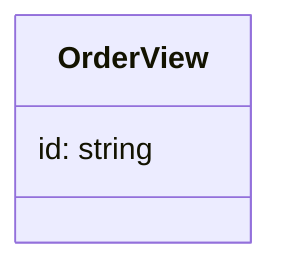
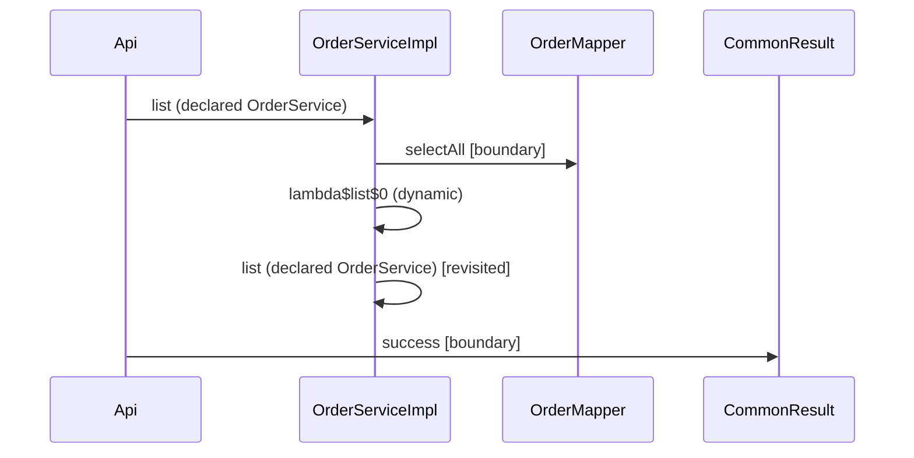
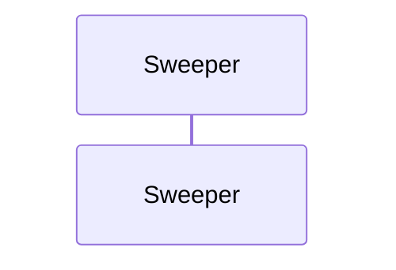

# com.example:golden

Generated from commit `0d17e2`.

## Coverage

- Documents analysed: 2
- Partial documents: 0
- Facts loaded: 7
- Environments resolved: none.
- Configuration keys unresolved: none.
- Unresolved endpoint derivations — across every engine, whatever their evidence, not configuration alone:
- None.
- Per-environment peer resolution is the system architecture document's material, not repeated per module here.

## Structure

## Inbound endpoints

| Endpoint | Handler | Media | Format | Resolution |
|---|---|---|---|---|
| `GET /v1/orders` | `Api#list` | — → application/json | json | resolved |

Media reads `consumes → produces`; `—` means none recorded.

- `GET /v1/orders` — `com/example/golden/Api#list().`

## Outbound endpoints

| Endpoint | Peer | Caller | Format | Resolution |
|---|---|---|---|---|
| `POST /billing/invoices` | https://billing.internal | `com/example/golden/BillingClient#charge().` | unresolved | resolved |

## Scheduled work

| Handler | Trigger | Expression | Resolution |
|---|---|---|---|
| `com/example/golden/Sweeper#sweep().` | cron | `${orders.sweep.cron}` | unresolved |

## Error handling

| Exception | Status | Handler | Declared by | Scope | Response |
|---|---|---|---|---|---|
| `OrderNotFound` | NOT_FOUND | `com/example/golden/Advice#notFound().` | ControllerAdvice | — | ErrorBody |

## Traces

- A trace is REACHABILITY, never execution: every step is a call the compiler recorded, branches are not distinguished, and two `return` statements are two possible answers rather than the one that runs. No path below is asserted to have happened.
- Steps are in the walk's own depth-first order, and `Depth` counts edges from the root — so a step's caller is named on its own row rather than left to be inferred from indentation.
- `Stop` says why a step was not expanded. `boundary` means this workspace read no body for the callee: a third-party library, the JDK, a MyBatis mapper and a SIBLING BUILD MODULE all read alike there, because each is a body that is not here. Nothing below classifies which — `terminal_kind` has no producer, and the `Call` column carries the full descriptor the compiler wrote so the distinction is the reader's to make.
- `revisited` means the callee was expanded ELSEWHERE in this same trace and its own calls are shown at that first appearance: a method is expanded once per trace, not once per route to it, so a path through one of these tables is not always followable to a terminal. `cycle` means the callee is already on the path from the root. `depth_limit` means the walk's safety bound stopped it, and the `Complete` column answers that without a reader scanning for it.
- `Value` is the value id the call site produced and `Returns` what the callee hands back — both LOCAL to the method on that row, so an id in a step's `Returns` is a value inside the callee and matches its own rows, never the caller's. `Response` is what the root method itself returns.

| Root | Starts as | Depth | Steps | Terminals | Complete |
|---|---|---|---|---|---|
| `com/example/golden/Api#list().` | inbound_endpoint | 3 | 5 | 2 | yes |
| `com/example/golden/Sweeper#sweep().` | scheduled | 0 | 0 | 0 | yes |

- `com/example/golden/Api#list().` — inbound_endpoint
  - Steps:

    | Depth | Caller | Call | Dispatch | Resolution | Value | Returns | Stop |
    |---|---|---|---|---|---|---|---|
    | 1 | `Api#list` | `com/example/golden/OrderService#list().` → `com/example/golden/OrderServiceImpl#list().` | interface | resolved | 7 | unresolved value 3 | — |
    | 2 | `OrderServiceImpl#list` | `com/example/golden/OrderMapper#selectAll().` | interface | resolved | 3 | — | boundary |
    | 2 | `OrderServiceImpl#list` | `com/example/golden/OrderServiceImpl#lambda$list$0().` | dynamic | resolved | — | — | — |
    | 3 | `OrderServiceImpl#lambda$list$0` | `com/example/golden/OrderService#list().` → `com/example/golden/OrderServiceImpl#list().` | interface | resolved | — | — | revisited |
    | 1 | `Api#list` | `com/example/common/api/CommonResult#success().` | static | resolved | 12 | — | boundary |
  - Response: unresolved value 12

Elides: Reachability, not execution: an arrow is a call the compiler recorded, not one observed to run, and branches are not distinguished — no order here is claimed to have happened. All 5 steps of this trace are drawn; nothing is filtered. Arrows ending at a lifeline this workspace read no body for — a library, the JDK, a mapper or a sibling build module alike — which the walk did not enter: 2. Arrows naming a method already expanded earlier in this trace, whose own calls are drawn at that first arrow and not repeated here: 1.

- `com/example/golden/Sweeper#sweep().` — scheduled
  - Steps: None — this root calls nothing.
  - Response: void

Elides: Reachability, not execution: an arrow is a call the compiler recorded, not one observed to run, and branches are not distinguished — no order here is claimed to have happened. This root calls nothing, so the diagram is its own lifeline and no arrow at all.

## Open questions

- `sqs order-intake` — payload_binding: com/acme/A# in R#r(). via parseFrom at 1 hop(s)
- `sqs order-audit` — payload_binding: com/acme/B# in S#s(). via readValue at 2 hop(s)

## Known gaps

- An @HttpExchange interface implemented server-side is still reported outbound.
- Base addresses built by computation — concatenation, setter injection, a method's return value — are not traced; only a directly-read field or property reaches configuration.
- Configuration constructed in code — a settings module, a config factory — is not read; only configuration files reach resolution.
- A trace is reachability, never execution: branches are not distinguished, two return statements are two possible answers rather than the one that runs, and no step is asserted to have happened.
- The structure diagram covers contract types only: inheritance edges are not extracted.
- A trace stops where this workspace read no body, and nothing classifies which kind of stop it is: a third-party library, the JDK, a MyBatis mapper and a SIBLING BUILD MODULE all read `boundary`. The last of those is the one that under-reports — a body exists somewhere, in a workspace this one does not hold — and on a multi-module build it is where a response is composed.
- A method is expanded once per trace, not once per route to it: a second route to the same method reads `revisited` and its calls are shown at the first, so a path through a trace is not always followable to a terminal.
- A trace's depth is bounded at 64 edges, which FR-6 says it should not be. The bound is a safety limit rather than a modelling one and it is never silent — the step says `depth_limit` and the Complete column answers — but a module deeper than 64 loses everything past it.
- A root is a handler this module exposes or schedules. A functional route carries no handler symbol, so it produces no root and gets no trace; a program entry point has no producer at all, so a module whose only starting point is a batch job or a command-line tool gets none either.
- Maven profiles and transitive dependencies are not resolved: the detector reads pom.xml files instead of asking Maven to resolve them. Parent inheritance, reactor `<modules>` discovery, `<dependencyManagement>`, imported BOMs and `${property}` interpolation ARE read — but a dependency declared inside a profile, and one that reaches the module only through another artifact's own dependencies, are absent from the recorded set.
- Catalogs are matched to modules only where the framework rule is conditional on the library being present: `detect.coordinates` is read, and such a catalog is skipped with a reason where the module's build declares none of them. Every other catalog still runs against every module whether or not the module depends on that framework — and a framework reaching a module only as another artifact's own transitive dependency cannot be told apart from an absent one.
- Module classification reads only a container file and a declared main class: a module showing neither is reported `undetermined` rather than weighed against the rest of the evidence.
- A path the module both exposes and calls keeps only the handler's declared contract: where the client's declaration differs, that difference is not recorded.
- Endpoint request and response contracts are scoped to the catalog that produced them. Shape expansion itself is not: a payload type reachable from several catalogs is still expanded once, under whichever catalog's rules reach it first, not necessarily the ones that produced the endpoint referencing it. The shipped catalogs do not declare identical rules, so a wrapper type one of them unwraps and another does not can be named below as unexpanded even where the shape behind it was expanded correctly.
- Reactive and lambda flow is recorded but not traced: calls inside flatMap and map derive endpoints, and a functional route's handler resolves, but the sequence between reactive calls — and the payloads read inside a functional handler's body — await the call graph.
- A bytes-only channel whose payload is parsed further than one delegation hop from its handler is not bound: the parse is found and listed as an open question instead, because a flow followed further than it was observed is an assumption, not a fact.
- A bytes-only channel whose payload reaches two different parses binds neither: two answers about one wire is a question for a reader, and picking the one that sorts first would publish a coin toss as a contract.
- Not read, so nothing above accounts for it: `com/example/golden/Newer.class: metadata unreadable`.
- Not expanded, so the shapes referring to it are open: `com/example/golden/Opaque#`.
- Not resolved, so nothing above accounts for it: library `com.example:absent` — no archive resolved the coordinate.

## Catalogs skipped

- `a-catalog` requires a-capability
