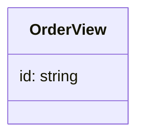

# com.example:golden

Generated from commit `0d17e2`.

## Coverage

- Documents analysed: 2
- Partial documents: 0
- Facts loaded: 7
- Environments resolved: none.
- Configuration keys unresolved: none.
- Unresolved endpoint derivations — across every engine, whatever their evidence, not configuration alone:
- None.
- Per-environment peer resolution is the system architecture document's material, not repeated per module here.

## Structure

## Inbound endpoints

| Endpoint | Handler | Media | Format | Resolution |
|---|---|---|---|---|
| `GET /v1/orders` | `Api#list` | — → application/json | json | resolved |

Media reads `consumes → produces`; `—` means none recorded.

- `GET /v1/orders` — `com/example/golden/Api#list().`

## Outbound endpoints

| Endpoint | Peer | Caller | Format | Resolution |
|---|---|---|---|---|
| `POST /billing/invoices` | https://billing.internal | `com/example/golden/BillingClient#charge().` | unresolved | resolved |

## Open questions

- `sqs order-intake` — payload_binding: com/acme/A# in R#r(). via parseFrom at 1 hop(s)
- `sqs order-audit` — payload_binding: com/acme/B# in S#s(). via readValue at 2 hop(s)

## Known gaps

- An @HttpExchange interface implemented server-side is still reported outbound.
- Base addresses built by computation — concatenation, setter injection, a method's return value — are not traced; only a directly-read field or property reaches configuration.
- Configuration constructed in code — a settings module, a config factory — is not read; only configuration files reach resolution.
- Sequence diagrams await the call graph.
- The structure diagram covers contract types only: inheritance edges are not extracted.
- The call graph is not implemented: there are no traces or sequence diagrams.
- Maven profiles and property interpolation are not resolved: the detector reads pom.xml directly instead of asking Maven to resolve it. Parent coordinate inheritance and reactor `<modules>` discovery ARE read, so an ordinary parent-and-children build detects correctly — but a coordinate behind a `${property}` or inside a profile is misread.
- Catalogs are not matched to modules: every catalog's `detect.coordinates` is declared and read by nobody, so every catalog runs against every module whether or not the module depends on that framework.
- Module classification reads only a container file and a declared main class: a module showing neither is reported `undetermined` rather than weighed against the rest of the evidence.
- A path the module both exposes and calls keeps only the handler's declared contract: where the client's declaration differs, that difference is not recorded.
- Endpoint request and response contracts are scoped to the catalog that produced them. Shape expansion itself is not: a payload type reachable from several catalogs is still expanded once, under whichever catalog's rules reach it first, not necessarily the ones that produced the endpoint referencing it. The shipped catalogs do not declare identical rules, so a wrapper type one of them unwraps and another does not can be named below as unexpanded even where the shape behind it was expanded correctly.
- Reactive and lambda flow is recorded but not traced: calls inside flatMap and map derive endpoints, and a functional route's handler resolves, but the sequence between reactive calls — and the payloads read inside a functional handler's body — await the call graph.
- A bytes-only channel whose payload is parsed further than one delegation hop from its handler is not bound: the parse is found and listed as an open question instead, because a flow followed further than it was observed is an assumption, not a fact.
- A bytes-only channel whose payload reaches two different parses binds neither: two answers about one wire is a question for a reader, and picking the one that sorts first would publish a coin toss as a contract.
- Not read, so nothing above accounts for it: `com/example/golden/Newer.class: metadata unreadable`.
- Not expanded, so the shapes referring to it are open: `com/example/golden/Opaque#`.
- Not resolved, so nothing above accounts for it: library `com.example:absent` — no archive resolved the coordinate.

## Catalogs skipped

- `a-catalog` requires a-capability
